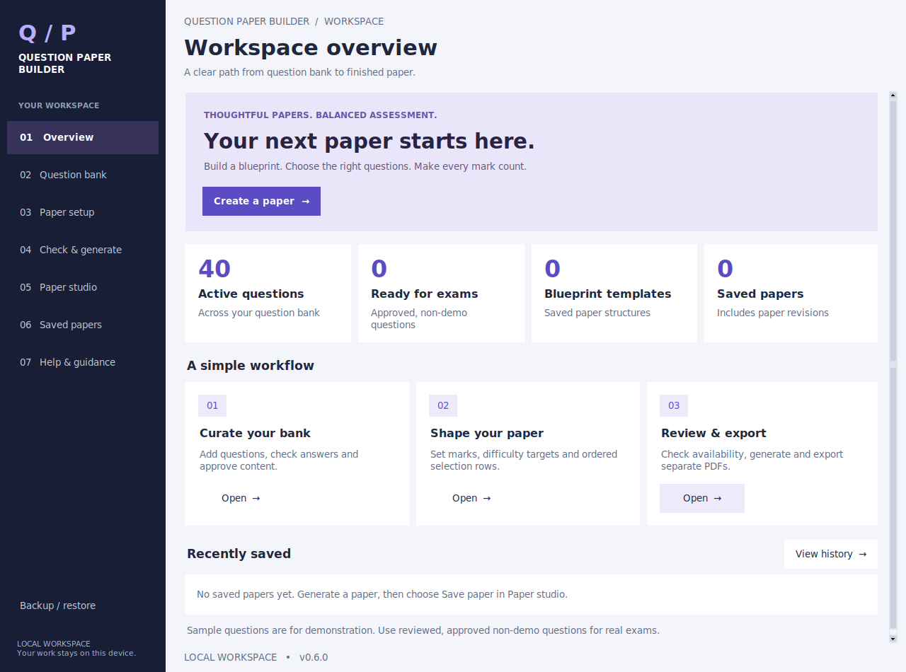
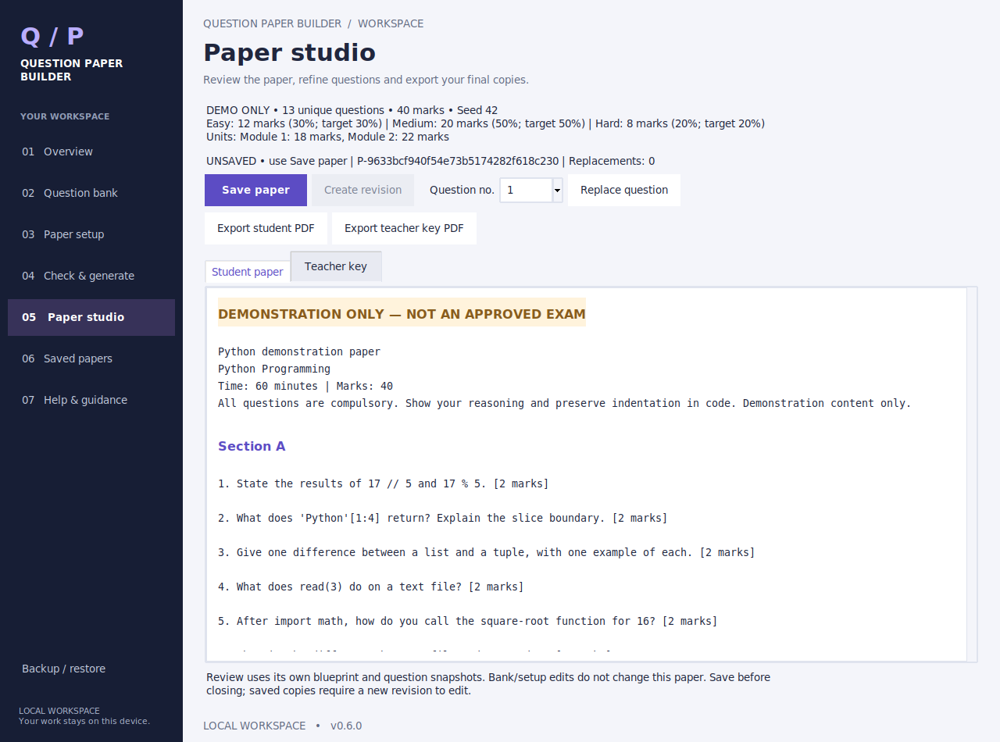
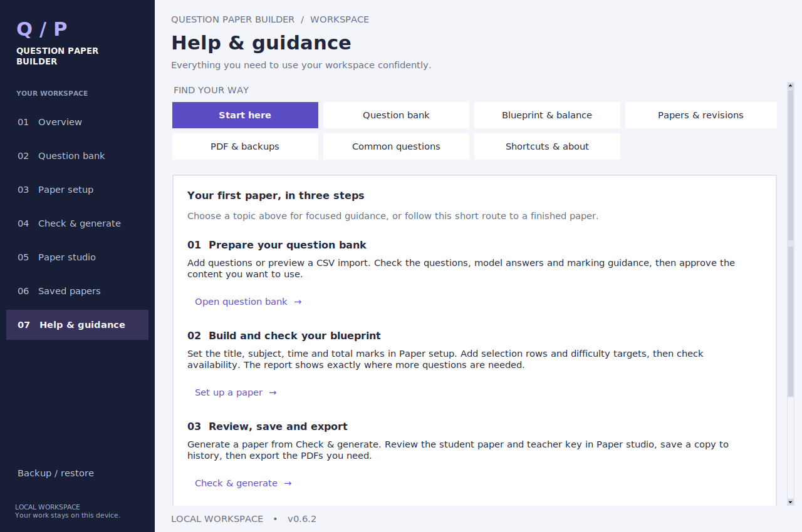

# Desktop workspace — 0.6.0

The redesign keeps the working Python/Tkinter architecture and gives the app a consistent visual language. No web server, browser login, JavaScript frontend or additional GUI dependency is needed.

## Visual system

| Element | Treatment |
|---|---|
| Navigation | Dark navy sidebar, numbered destinations, active-page highlight, Ctrl+1–7 shortcuts |
| Workspace | Light grey canvas, white cards, clear page titles and short descriptions |
| Primary actions | Indigo buttons for creating, saving, approving and generating |
| Typography | Segoe UI on Windows; DejaVu Sans fallback; monospace text for code-bearing fields |
| Data tables | Taller rows, alternating backgrounds, readable selection state and internal scrollbars |
| Previews | White paper surface, section hierarchy, amber demonstration warning, preserved source text |
| Small windows | Reflowing overview cards, scrollable pages/sidebar and focus-driven control visibility |

The overview reads actual database records. “Ready for exams” counts only active, approved, non-demo questions; it is not a guarantee that every blueprint can be fulfilled. Availability still checks the exact selected blueprint.

The question bank puts the prompt immediately after the ID, uses compact review labels and retains complete content in the lower detail panel. The divider can be dragged to resize the table and detail areas. The editor, CSV importer, blueprint editor, replacement dialog and backup dialog share the same native styles.

## Reference sites

Reviewed on 25 October 2026, using the examples supplied by the user:

- [Create Question Paper](https://createquestionpaper.in/): prominent creation entry point and clear user tasks.
- [QP Creator](https://qpcreator.com/): clear primary action and grouped feature information.
- [Examin8](https://examin8.com/): setup, curation/review and export as a guided sequence.
- [Eklavvya question paper generator](https://www.eklavvya.com/free-question-paper-generator/): distinct setup, generation and preview areas.

These informed the workflow hierarchy. The palette and desktop layouts are original; no logos, screenshots, brand assets or marketing claims were copied. Website-only AI, payment and account features were not added.

## Actual application screenshots

Rendered with Tk 8.6 on Linux using bundled demo questions. Windows uses its installed Segoe UI font and native window decorations, so details can differ.

## Update and acceptance

Close the running app and replace the application code with 0.6.0. Run `py -3.12 main.py`; the title bar should show 0.6.0. Keep the default database in its existing location. No schema migration or dependency installation is required by this redesign.

Automated evidence is in [TEST_RESULTS.md](TEST_RESULTS.md). Before submission, check the following on the user's Windows computer:

- [ ] Open each sidebar page at the usual screen size and 125%/150% Windows scaling.
- [ ] Use Tab/Shift+Tab, Ctrl+1–7 and the page scrollbars; verify that focused controls remain reachable.
- [ ] Edit a coding question, scroll to marking guidance, save and re-open it.
- [ ] Load a blueprint, check availability, generate, replace a question and save a revision.
- [ ] Export student and teacher PDFs; confirm the correct audience and indentation.
- [ ] Make and restore a disposable backup, confirming the recovery copy and reopen behavior.
- [ ] Observe a teacher completing a paper and record any confusing labels or steps before collecting satisfaction feedback.

The redesign changes presentation. It does not change selection rules, saved-paper immutability, PDF formatting, backup safeguards or demo eligibility.

## 0.6.1 refinement

Mouse-wheel routing and Windows system-DPI startup were added after the user's feedback about scrolling and the quality of the whole window. Larger fonts and themed text-box scrollbars improve consistency. The screenshots above document the initial 0.6.0 design; its layout and palette are retained. Use a fresh Python process to activate the DPI startup change. A final Windows visual check is still required.

## 0.6.2 council review and refinements

On 26 October 2026, visual-design and usability reviewers assessed the user's Windows screenshots. Both recommended improving composition within Tkinter before considering a frontend migration. The key weaknesses were text-heavy Help, an inactive-control wall in empty Paper studio, competing actions, long timestamps and excessive dashboard height.

The implemented pass adds a seven-topic Help centre, navigation-only guidance buttons, a Paper studio starting card, grouped generation settings, quiet secondary actions, compact number inputs, readable UTC dates and a selected-paper detail panel. Recently saved work now precedes the workflow cards. The original palette and native keyboard controls remain.

Research used:

- [Microsoft: Content layout and spacing](https://learn.microsoft.com/en-us/windows/apps/design/basics/content-basics) — consistent spacing, typographic hierarchy and related control groups.
- [Nielsen Norman Group: Ten usability heuristics](https://www.nngroup.com/articles/ten-usability-heuristics/) — familiar wording, reduced visual clutter and findable task-focused help.

These are design principles, not evidence that this app will improve retention. That needs observation of real users. No new language or GUI framework was introduced; the user's approval would be requested before such a migration.

Version 0.6.2 keeps generation, saving, revision, PDF export and backup services unchanged. Help actions only select an existing page. Readable dates are display-only; raw timestamps and identifiers remain in storage.

Actual 0.6.2 Help centre (Linux/Tk 8.6, not a mockup):

